<!-- ═══════════════════════════ HEADER ═══════════════════════════ -->

<div align="center">
  
</div>

<div align="center">
  <a href="https://codeofsagar.in">
    
  </a>
</div>

<div align="center">
  <a href="https://codeofsagar.in"></a>
  <a href="https://www.linkedin.com/in/sagar-kumar-ghosh-1b6167346"></a>
  <a href="mailto:hello@codeofsagar.in"></a>
  
</div>


<!-- ═══════════════════════════ ABOUT ═══════════════════════════ -->


###  &nbsp;whoami

```ts
const sagar = {
  role:      "MERN Stack Developer",
  focus:     "Frontend motion & modern UI",
  stack:     ["Next.js", "React", "TypeScript", "Node", "MongoDB"],
  weapons:   ["GSAP", "Framer Motion", "WebGL", "Three.js"],
  learning:  "Advanced 3D web experiences",
  age:       22,
  obsession: "Making the web feel alive",
} as const;
```

- 🌐 &nbsp;Live work → **[codeofsagar.in](https://codeofsagar.in)**
- 🎨 &nbsp;I care about the **last 10%** — easing curves, stagger timing, the frame you almost don't notice
- 🧪 &nbsp;Currently deep in **shaders, scroll-driven scenes, and 3D on the web**
- 🤝 &nbsp;Open to collaborating on anything that needs to look *expensive*
- ⚡ &nbsp;Fun fact: I'm 22, and already building the web I want to browse

<br clear="right" />


<!-- ═══════════════════════════ STACK ═══════════════════════════ -->

<h3 align="center">⚡ &nbsp;Arsenal</h3>

<div align="center">

**Frontend**


**Backend &amp; Data**


**Tooling**


<br />


</div>


<!-- ═══════════════════════════ STATS ═══════════════════════════ -->

<h3 align="center">📊 &nbsp;The Numbers</h3>

<div align="center">
  
  
</div>

<div align="center">
  
</div>


<!-- ═══════════════════════════ SNAKE ═══════════════════════════ -->

<h3 align="center">🐍 &nbsp;Watch My Commits Get Eaten</h3>

<div align="center">
  <picture>
    <source media="(prefers-color-scheme: dark)" srcset="https://raw.githubusercontent.com/codeofsagar/codeofsagar/output/github-contribution-grid-snake-dark.svg" />
    <source media="(prefers-color-scheme: light)" srcset="https://raw.githubusercontent.com/codeofsagar/codeofsagar/output/github-contribution-grid-snake.svg" />
    
  </picture>
</div>


<!-- ═══════════════════════════ EXTRAS ═══════════════════════════ -->

<details>
<summary><b>🎯 &nbsp;What I'm building right now</b></summary>

<br />

| Project | What it is | Status |
| :--- | :--- | :--- |
| **Portfolio v3** | WebGL-driven personal site with scroll-linked scenes | 🟢 Live |
| **Motion Lab** | A playground of reusable GSAP + Framer Motion patterns | 🟡 In progress |
| **3D Experiments** | Three.js / R3F studies — shaders, particles, physics | 🔬 Ongoing |

<sub>Swap these rows for your real projects — the table format keeps it scannable.</sub>

</details>

<details>
<summary><b>🧠 &nbsp;Things I believe about frontend</b></summary>

<br />

> **Motion is meaning.** An animation that doesn't explain a state change is decoration.
>
> **Easing > duration.** Nobody notices `300ms`. Everybody notices `ease-linear`.
>
> **60fps is a feature.** If it janks, it's broken — no matter how it looks in a screenshot.
>
> **The last 10% is the product.** Anyone can ship the layout. Polish is the differentiator.

</details>


<!-- ═══════════════════════════ CONNECT ═══════════════════════════ -->

<h3 align="center">🤝 &nbsp;Let's Build Something</h3>

<p align="center">
  Got an idea that needs to <i>move</i>? I'm one message away.
</p>

<div align="center">
  <a href="https://codeofsagar.in"></a>
  &nbsp;
  <a href="https://www.linkedin.com/in/sagar-kumar-ghosh-1b6167346"></a>
  &nbsp;
  <a href="mailto:hello@codeofsagar.in"></a>
  &nbsp;
  <a href="https://github.com/codeofsagar"></a>
</div>

<br />

<div align="center">
  <i>"Make it work, make it right, make it fast." — Kent Beck</i>
</div>

<br />

<div align="center">
  <i>⭐ If something here was useful, a star costs you nothing and makes my day.</i>
</div>

<div align="center">
  
</div>
